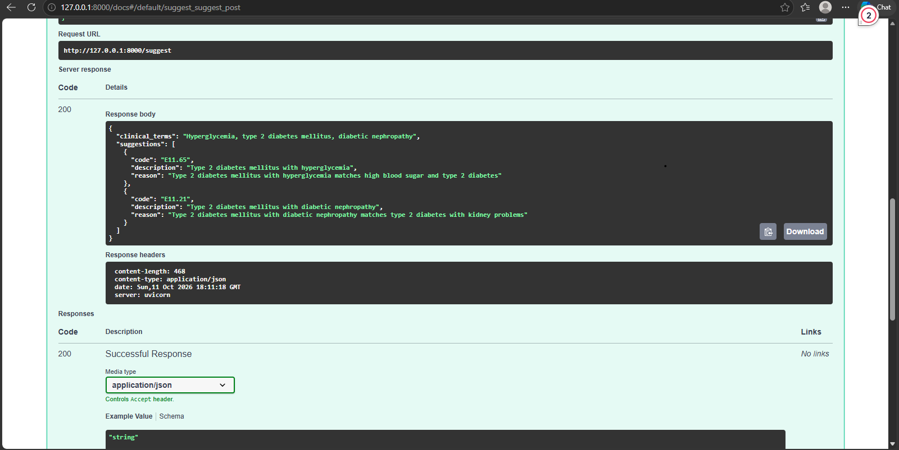

# ICD-10 Assistant

Describe a patient's problem in plain English and get back suggested ICD-10 diagnosis codes, each with a short reason. Built with LangChain, FastAPI, and MySQL, and deployed live.

**Try it:** https://langchain-icd10-assistant.onrender.com/docs
*(Free hosting: the first request after a quiet period can take up to a minute to wake up.)*



## Why I built it

Medical coding is slow and detail-heavy. I combined my healthcare and coding background with AI to build a tool that speeds up the first step: finding the right code for a written description.

## What it does

**Input**

```json
{"description": "patient has chest pain and shortness of breath"}
```

**Output**

```json
{
  "clinical_terms": "Chest pain; dyspnea",
  "suggestions": [
    {"code": "R07.9", "description": "Chest pain, unspecified", "reason": "..."},
    {"code": "R06.00", "description": "Dyspnea, unspecified", "reason": "..."}
  ]
}
```

## How it works

1. An LLM rewrites everyday wording into clinical terms.
2. Those terms search the ICD-10 table in MySQL for up to 25 candidate codes.
3. The LLM picks the best matches and explains each choice.
   Searching the database first keeps the suggestions tied to real codes instead of letting the model invent them.
## Limitations and safety

- Suggestions are a starting point for a human coder, not a final answer. They are not for clinical or billing use without review by a qualified coder.
- Do not enter real patient information. This is a demo and requests are sent to a third-party LLM service.
- Search is keyword-based (MySQL full-text), so a query like "type 2 diabetes" can return Type 1 codes in the candidate list. The LLM's picking step corrects most of this, but not always.
- Covers ICD-10 diagnosis codes only, not procedure codes.


## Skills shown

- **AI/LLM engineering:** LangChain pipeline, prompt design, OpenRouter model integration
- **Backend:** REST API with FastAPI, request validation, MySQL queries
- **Deployment:** Docker, Render, managed cloud database (Aiven), environment-based configuration
- **Practice:** Secrets kept out of the repo, debugging from production logs
- **Domain knowledge:** ICD-10 coding and clinical terminology

## Tech stack

Python, FastAPI, LangChain, OpenRouter, MySQL (Aiven), Docker, Render

## Run it locally

```bash
git clone https://github.com/hopemutheu733-cmd/langchain-icd10-assistant.git
cd langchain-icd10-assistant
pip install -r requirements.txt
cp .env.example .env   # add your database and OpenRouter details
uvicorn api:app --reload
```

Open http://127.0.0.1:8000/docs. The ICD-10 data file is large, so it is not included in the repo.

## Note

This is a portfolio project, not a medical device. A qualified coder should verify any code before real use.

## Author

**Hope Mutheu**, [GitHub: hopemutheu733-cmd](https://github.com/hopemutheu733-cmd)
